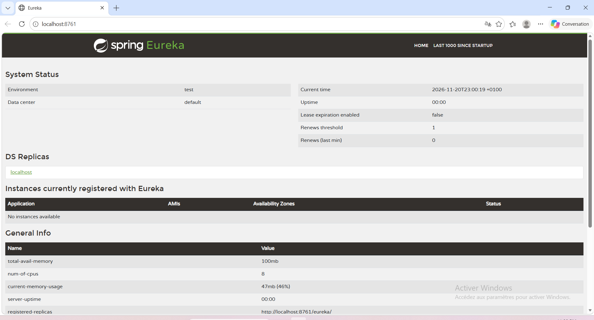
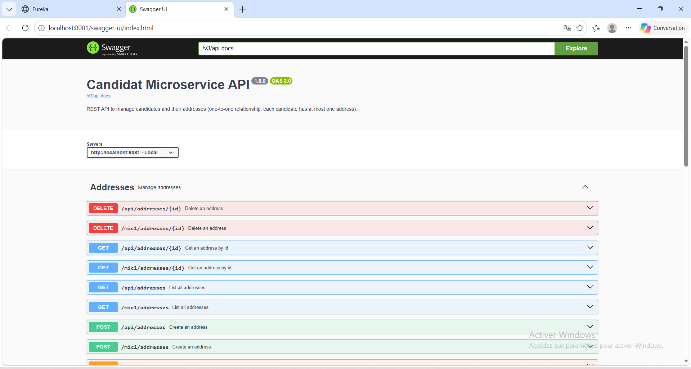
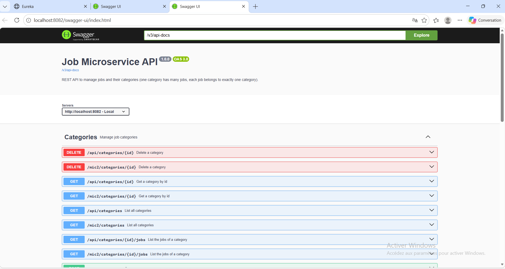
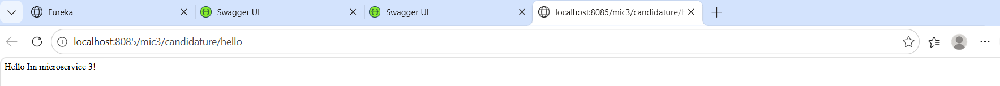
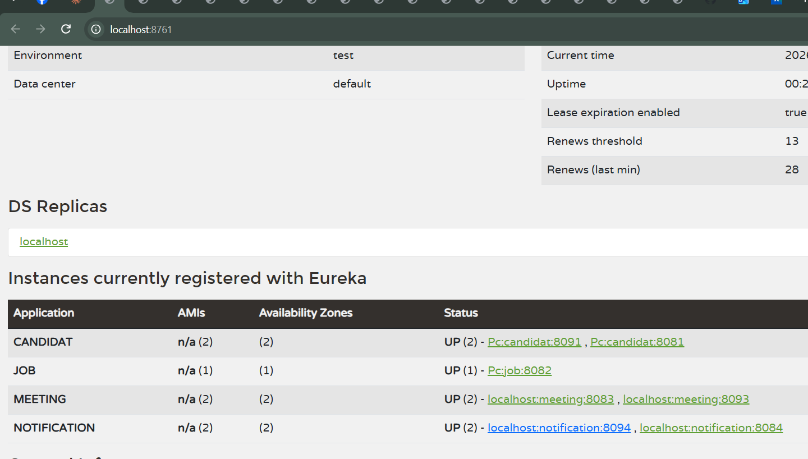
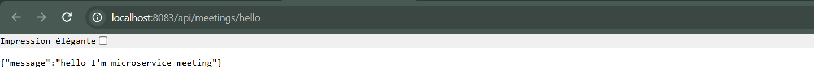
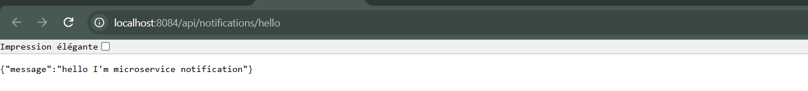

# Atelier 1 — Implémentation « Eureka Server »

Architecture Web Distribuée — ESPRIT — A.U. 2026-2027

**Équipe :** Molka Jebali, Zeineb Arfaoui

## Objectif

Mettre en place un serveur de découverte **Eureka**, y enregistrer les microservices Spring Boot **Candidat**, **Job** et **Candidature**, ainsi que **Meeting** (Node.js) et **Notification** (Python), puis lancer plusieurs instances d'un même service.

## Architecture

| Microservice | Technologie | Port | Nom dans Eureka |
|---|---|---|---|
| Eureka Server | Spring Boot 3.5 + Spring Cloud 2025.0 | 8761 | – |
| Candidat | Spring Boot + H2 | 8081 | CANDIDAT |
| Job | Spring Boot + MySQL | 8082 | JOB |
| Candidature | Spring Boot + Spring Cloud 2025.1 | 8085 | CANDITATURE |
| Meeting | Node.js / Express | 8083 | MEETING |
| Notification | Python / FastAPI | 8084 | NOTIFICATION |

> Le nom Eureka de Candidature est `CANDITATURE` car c'est la valeur de `spring.application.name` dans le projet fourni.

## Ce qui a été fait

| Partie | Modification | Fichier |
|---|---|---|
| 1 | Projet Eureka Server : dépendance `spring-cloud-starter-netflix-eureka-server`, `@EnableEurekaServer` | `backend/eureka/pom.xml`, `EurekaApplication.java` |
| 1 | Propriétés du serveur (port 8761, ne s'enregistre pas lui-même) | `backend/eureka/src/main/resources/application.properties` |
| 2 | Dépendance `spring-cloud-starter-netflix-eureka-client` + `@EnableDiscoveryClient` | `pom.xml` et `*Application.java` de Candidat, Job, Candidature |
| 2 | Propriétés `eureka.client.*` et `eureka.instance.prefer-ip-address` | `application.properties` de chaque service |
| 3 | Meeting : `eureka-js-client`, nom `MEETING`, port lu dans `PORT` | `meeting/src/config/eureka.js`, `src/server.js` |
| 3 | Notification : `py-eureka-client`, nom `NOTIFICATION`, `lifespan`, port lu dans `PORT` | `notification/app/main.py`, `requirements.txt` |

Les tests existants ne s'enregistrent pas dans Eureka (`eureka.client.enabled=false` côté test).

## Lancement

Ordre : **MySQL (XAMPP)** → **Eureka** → Candidat, Candidature, Job → Meeting, Notification.

```bat
setup-database.bat      :: une seule fois (MySQL démarré)
start-all.bat           :: lance Eureka, attend 30 s, puis les 5 microservices
```

Ou service par service : `run-eureka.bat`, `run-candidat.bat`, `run-job.bat`, `run-candidature.bat`, `run-meeting.bat`, `run-notification.bat`.

Dashboard : <http://localhost:8761>

### Plusieurs instances

```bat
run-candidat-2.bat      :: Candidat sur 8091
run-meeting-2.bat       :: Meeting sur 8093 (PORT=8093)
run-notification-2.bat  :: Notification sur 8094 (PORT=8094)
```

Pour Notification, le port d'uvicorn et la variable `PORT` doivent être identiques (le script s'en charge).

## Vérifications et captures

### Dashboard Eureka au démarrage (aucune instance)



### Services testés avant l'enregistrement







### Dashboard Eureka : tous les services et plusieurs instances

CANDIDAT `UP (2)` (8081 et 8091), JOB (8082), MEETING `UP (2)` (8083 et 8093), NOTIFICATION `UP (2)` (8084 et 8094).



### Endpoints hello après enregistrement





## Rapport

`Rapport_Atelier1_Eureka` (Word / PDF exporté depuis le document Claude).
