# Atelier 2 — Observabilité avec Spring Boot Actuator

Architecture Web Distribuée — ESPRIT — A.U. 2026-2027 (suite de l'atelier Eureka)

**Équipe :** Molka Jebali, Zeineb Arfaoui

## Objectif

Ajouter **Spring Boot Actuator** à Candidat, Job et Candidature, lire `/actuator/health`, `/info`, `/metrics`, changer un niveau de log à chaud avec `/loggers`, écrire un `HealthIndicator` personnalisé, faire remonter la santé dans Eureka (UP → DOWN), et exposer `/health` et `/info` pour Meeting (Node.js) et Notification (Python).

## Ce qui a été fait

| Partie | Modification | Fichier |
|---|---|---|
| 1 | Dépendance `spring-boot-starter-actuator` | `pom.xml` de Candidat, Job, Candidature |
| 1 | Exposition de `health,info,metrics,loggers`, détails de santé, `eureka.client.healthcheck.enabled=true`, `management.info.env.enabled=true`, `info.app.*` | `application.properties` de chaque service |
| 3 | `/actuator/loggers` exposé pour changer les niveaux de log sans redémarrage | `application.properties` |
| 4 | `HealthIndicator` personnalisé `jobCatalog` (lit les tables `job` et `category`, DOWN si la lecture échoue) | `job/src/main/java/com/awd/job/health/JobCatalogHealthIndicator.java` |
| 5 | Meeting : routes `GET /health`, `GET /info` (lues dans `package.json`), `healthCheckUrl` et `statusPageUrl` déclarés | `meeting/src/app.js`, `src/config/eureka.js` |
| 5 | Notification : routes `GET /health`, `GET /info`, paramètres `health_check_url` et `status_page_url` | `notification/app/main.py` |

> Le sujet fourni (PDF) ne contient pas les parties 3 et 4, mais les objectifs les mentionnent (loggers, `HealthIndicator`, statut dans Eureka). Elles ont été réalisées d'après ces objectifs.

## Lancement

Ordre : **MySQL** → **Eureka** → Candidat, Candidature, Job → Meeting, Notification (`start-all.bat`).

## Scénarios à exécuter

| Étape | Action | Résultat attendu |
|---|---|---|
| Info | `http://localhost:8081/actuator/info` | JSON avec `app.name`, `version`, `description`, `team` |
| Health | `http://localhost:8082/actuator/health` | `status: UP`, composants `db`, `jobCatalog`, `diskSpace`, `ping`… |
| Panne | Arrêter MySQL (XAMPP), rappeler `/actuator/health` de Job | `status: DOWN`, `db` et `jobCatalog` en `DOWN` (HTTP 503) |
| Eureka | Dashboard `localhost:8761` après la panne | JOB en `DOWN` (l'instance peut mettre jusqu'à environ 30 s à changer) |
| Reprise | Redémarrer MySQL | JOB repasse `UP` |
| Metrics | `/actuator/metrics`, `/actuator/metrics/jvm.memory.used` | Liste des métriques, puis valeur mémoire |
| Metrics HTTP | Appeler `/api/candidates` plusieurs fois, puis `/actuator/metrics/http.server.requests` et `...?tag=status:200` | Mesures `COUNT`, `TOTAL_TIME`, `MAX` |
| Loggers | `GET /actuator/loggers/com.awd.job` puis `POST` avec `{"configuredLevel":"DEBUG"}` | Niveau modifié sans redémarrage |
| Node/Python | `http://localhost:8083/health`, `/info` et `8084/health`, `/info` | `{"status":"UP"}` et nom/version |
| Registre | `http://localhost:8761/eureka/apps/NOTIFICATION` | `healthCheckUrl` et `statusPageUrl` présents |

Exemples de commandes pour les loggers (PowerShell 5.1 : `curl.exe`, JSON **entre apostrophes** ; avec des guillemets doubles autour du JSON, PowerShell renvoie « URL rejected » puis une erreur 400) :

```bat
curl.exe http://localhost:8082/actuator/loggers/com.awd.job
curl.exe -X POST -H "Content-Type: application/json" -d '{\"configuredLevel\":\"DEBUG\"}' http://localhost:8082/actuator/loggers/com.awd.job
curl.exe http://localhost:8082/actuator/loggers/com.awd.job
```

Alternative : `Invoke-RestMethod -Method Post -ContentType 'application/json' -Body '{"configuredLevel":"DEBUG"}' http://localhost:8082/actuator/loggers/com.awd.job`

## Captures

### Santé dans Eureka : JOB passe DOWN puis UP

Après l'arrêt de MySQL, JOB passe en `DOWN (1)` dans le dashboard alors que les autres services restent `UP` :

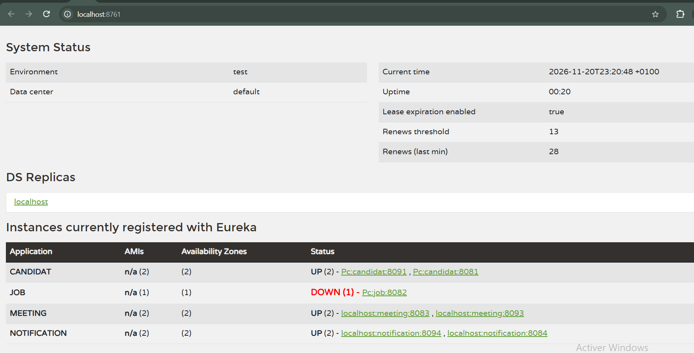

Après le redémarrage de MySQL, JOB repasse `UP` :

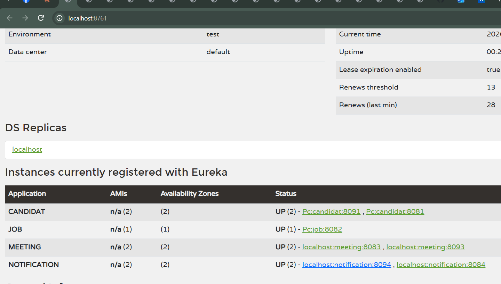

### `/actuator/info` (Candidat)

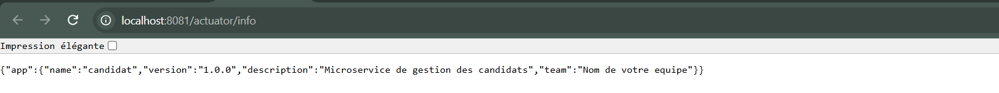

> Au moment de la capture, `info.app.team` contenait encore la valeur par défaut du sujet ; elle vaut maintenant `Molka Jebali, Zeineb Arfaoui`.

### Métriques (Candidat)

Appel de `/api/candidates` pour alimenter les métriques HTTP :

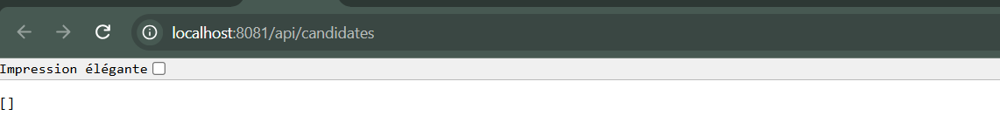

`jvm.memory.used` (environ 195,5 Mo) :

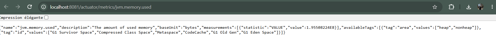

`http.server.requests` : `COUNT` = 30, `TOTAL_TIME` ≈ 1,43 s, `MAX` ≈ 0,311 s :

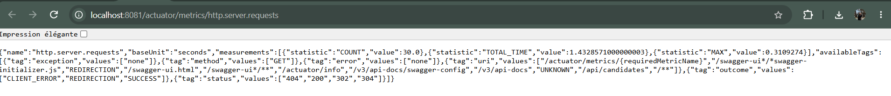

`http.server.requests?tag=status:200` : `COUNT` = 24 (les 6 autres requêtes ont les statuts 404, 302 ou 304), `MAX` ≈ 0,311 s :

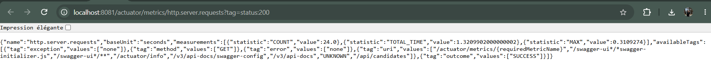

### Meeting (Node.js) : `/health` et `/info`

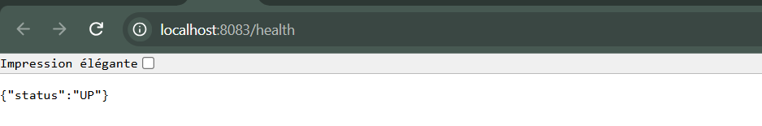

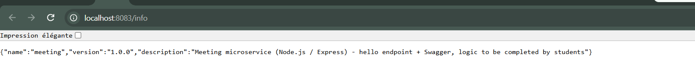

### Notification (Python) : `/health` et `/info`

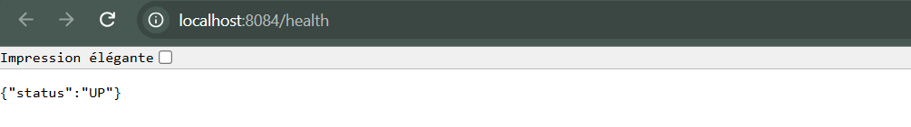

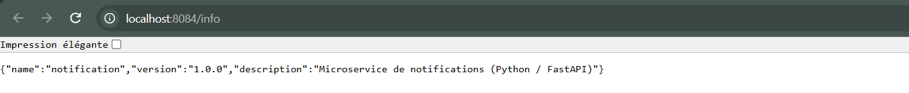

## Rapport

`Rapport_Atelier2_Actuator` (Word / PDF exporté depuis le document Claude).
